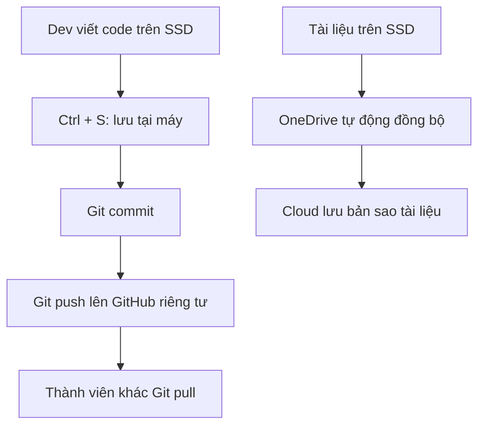

# GREEN-TECH – Không gian cộng tác dự án Trang trại thông minh

## 1. Giới thiệu

Nhóm em xây dựng dự án **Green-Tech** để quản lý hệ thống cảm biến trong trang trại. Vì có nhiều người cùng làm việc nên nhóm cần lưu code an toàn, chia sẻ báo cáo đúng quyền và theo dõi công việc rõ ràng.

Nhóm sử dụng **GitHub** để quản lý phiên bản code, **OneDrive** để lưu tài liệu và **Lark** để trao đổi, giao việc.

## 2. Cấu trúc thư mục

```text
Green-Tech/
├── source-code/                # Code dự án (quản lý trên GitHub)
│   ├── sensors/                # Code đọc dữ liệu cảm biến
│   ├── backend/                # Xử lý dữ liệu
│   ├── frontend/               # Giao diện theo dõi
│   ├── .env.example            # Mẫu tên biến, không chứa mật khẩu thật
│   └── .gitignore              # Loại trừ .env và file nhạy cảm
├── reports/                    # Báo cáo tiến độ, kết quả
│   ├── internal/               # Báo cáo nội bộ
│   └── investors/              # Báo cáo dành cho nhà đầu tư
├── partners/                   # Tài liệu trao đổi với nhà cung cấp
└── project-management/         # Kế hoạch và phân công công việc
```

**Lưu ý:** File `.env` thật chỉ nằm trên máy hoặc môi trường triển khai được bảo vệ, không đưa lên GitHub, OneDrive dùng chung hay gửi qua chat. Nếu cần dùng chung mật khẩu, nhóm sử dụng nơi quản lý bí mật có phân quyền riêng.

## 3. Chức năng 1 – Hybrid Workflow

Quy trình làm việc của đội Dev:

1. Lập trình viên chỉnh sửa code trong thư mục dự án trên **SSD** và nhấn `Ctrl + S` để lưu vào máy.
2. Sau khi kiểm tra, lập trình viên dùng `git add`, `git commit` và `git push` để đưa code lên **GitHub repository riêng tư**.
3. Các thành viên khác dùng `git pull` để cập nhật. Báo cáo và tài liệu được lưu trong thư mục **OneDrive** để tự động đồng bộ khi có mạng.



**Khi mất Internet:** Code và tài liệu đã lưu vẫn còn trên SSD. Git commit vẫn thực hiện được khi offline; khi có mạng mới `git push`. OneDrive sẽ tiếp tục đồng bộ các thay đổi còn chờ sau khi kết nối lại. Nhóm phải kiểm tra trạng thái đồng bộ thành công trước khi coi dữ liệu đã có bản trên Cloud.

**Khi xảy ra xung đột:** Không ghi đè ngay. Nhóm so sánh thay đổi bằng Git và giải quyết merge conflict; với tài liệu thì kiểm tra các bản xung đột hoặc Version History rồi chọn bản đúng.

## 4. Chức năng 2 – Phân quyền chia sẻ

| Đối tượng | Quyền | Nội dung được truy cập |
|---|---|---|
| Trưởng dự án | Owner / quản trị | Quản lý dự án, thành viên và quyền truy cập |
| Đội Dev | Editor (theo nhiệm vụ) | Code và tài liệu kỹ thuật nội bộ |
| Nhà đầu tư | Viewer | Chỉ xem thư mục `reports/investors/` |
| Đối tác cung cấp thiết bị | Commenter | Góp ý trong tài liệu được chia sẻ ở `partners/` |
| Người ngoài khác | Không có quyền | Không được truy cập |

**Cách thực hiện:** Chỉ chia sẻ cho email được xác nhận, không bật chế độ “Anyone with the link”. Nhà đầu tư không được sửa báo cáo. Đối tác chỉ bình luận trên tài liệu cần góp ý, không có quyền sửa code. Nhóm kiểm tra danh sách người có quyền truy cập định kỳ.

## 5. Chức năng 3 – Enterprise Communication

Nhóm tạo các kênh trong **Lark**:

| Channel | Nội dung |
|---|---|
| `#announcements` | Thông báo quan trọng, lịch họp |
| `#sensor-dev` | Trao đổi code và thiết bị cảm biến |
| `#bug-reports` | Báo lỗi, hình ảnh, cách tái hiện lỗi |
| `#tasks-deadlines` | Theo dõi công việc và hạn hoàn thành |
| `#reports` | Tiến độ và báo cáo nội bộ |
| `#general` | Trao đổi chung |

### Chuyển lỗi cảm biến thành Task

Ví dụ cảm biến độ ẩm trả về giá trị sai:

1. Thành viên đăng trong `#bug-reports`: tên cảm biến, lỗi gặp phải, thời điểm xảy ra và ảnh/log (đã ẩn thông tin nhạy cảm).
2. Cả nhóm dùng **Reply in Thread** để thảo luận đúng dưới tin nhắn đó, không làm trôi thông tin trong kênh chính.
3. Trưởng nhóm tạo **Task trên Lark**, giao cho bạn phụ trách, đặt deadline và cập nhật trạng thái.

**Task mẫu:**

- **Tên:** Sửa lỗi cảm biến độ ẩm trả về `0%`.
- **Người phụ trách:** Thành viên Dev A.
- **Deadline:** 17:00 ngày 06/11/2026.
- **Trạng thái:** To do → In progress → Done.
- **Điều kiện hoàn thành:** Đọc được giá trị đúng, kiểm thử thành công và đẩy code lên GitHub.

Nhóm không yêu cầu mọi người trả lời ngay lập tức, trừ sự cố thật sự khẩn cấp. Tin nhắn cần ghi rõ vấn đề, người phụ trách và thời hạn phản hồi.

## 6. Bảo vệ file `.env`

File `.env` có thể chứa mật khẩu Wi-Fi, khóa API hoặc thông tin đăng nhập cảm biến. Vì vậy nhóm quy định:

- Thêm `.env`, `.env.*` vào `.gitignore` nhưng cho phép `.env.example`.
- Không gửi mật khẩu vào Lark, GitHub hay thư mục Cloud chia sẻ chung.
- Chỉ cấp quyền đọc bí mật cho thành viên thực sự cần sử dụng.
- Nếu lỡ đẩy mật khẩu lên GitHub, phải **đổi hoặc thu hồi mật khẩu ngay**, sau đó xử lý dữ liệu đã lộ trong lịch sử Git. Xóa file ở commit mới là chưa đủ.

## 7. Kiểm thử – Lỡ xóa thư mục `sensors`

**Giả định:** Một thành viên vô tình xóa toàn bộ `source-code/sensors/`.

**Cách khôi phục nhanh:**

1. **Dừng đồng bộ/xử lý thay đổi sai:** Báo cả nhóm tạm thời không commit hoặc push thêm thao tác xóa. Kiểm tra thư mục đã bị xóa ở máy hay đã lên GitHub.
2. **Lấy lại phiên bản ổn định:** Nếu thư mục đã được Git theo dõi, dùng lịch sử commit để phục hồi. Ví dụ, tại thư mục gốc repository, khi bản `HEAD` vẫn còn `sensors`:

   ```bash
   git restore --source=HEAD -- source-code/sensors/
   ```

   Nếu commit mới nhất cũng đã xóa thư mục, chọn commit tốt trước đó:

   ```bash
   git log --oneline -- source-code/sensors/
   git restore --source=<ma-commit-tot> -- source-code/sensors/
   ```

3. **Kiểm tra và cập nhật:** Chạy thử code cảm biến. Nếu khôi phục đúng, tạo commit mới và push lên GitHub để cả nhóm cập nhật. Nếu `sensors` là thư mục tài liệu trên OneDrive thay vì Git, vào **Recycle Bin** của OneDrive để Restore; có thể kiểm tra Version History đối với file còn tồn tại.

**Kết quả mong đợi:** Khôi phục lại được thư mục `sensors` ở phiên bản ổn định, không làm mất các thay đổi hợp lệ khác.

## 8. Bàn giao dự án bằng Transfer Ownership

Khi kết thúc bài tập nhóm, trưởng dự án:

1. Kiểm tra code, tài liệu, Task và danh sách thành viên; xóa quyền của người không còn tham gia.
2. Chuyển quyền sở hữu/quản trị các tài nguyên cho người tiếp nhận: chuyển ownership của file/thư mục trên nền tảng hỗ trợ; với GitHub chuyển repository sang tài khoản hoặc tổ chức nhận bàn giao theo quyền được phép; với Lark bàn giao quyền quản trị workspace/nhóm và Task phù hợp.
3. Yêu cầu người nhận xác nhận truy cập được tài nguyên, sau đó thu hồi quyền không cần thiết của trưởng nhóm cũ. **Không bàn giao mật khẩu bằng cách gửi file `.env` qua chat.**

*Lưu ý:* Tên và thao tác Transfer Ownership có thể khác nhau giữa OneDrive, GitHub và Lark; một số loại tài khoản không hỗ trợ chuyển chủ sở hữu trực tiếp. Khi đó cần quản trị viên hỗ trợ hoặc chuyển tài nguyên theo cách được hệ thống cho phép.

## 9. Kết luận

Qua bài tập, nhóm em hiểu cách kết hợp **SSD + GitHub + OneDrive** để lưu trữ an toàn, phân quyền đúng cho nhà đầu tư và đối tác, đồng thời dùng **Lark** để biến các lỗi cảm biến thành công việc có người phụ trách và deadline. Việc bảo vệ file `.env`, khôi phục dữ liệu và bàn giao quyền quản lý giúp dự án hoạt động rõ ràng và an toàn hơn.
